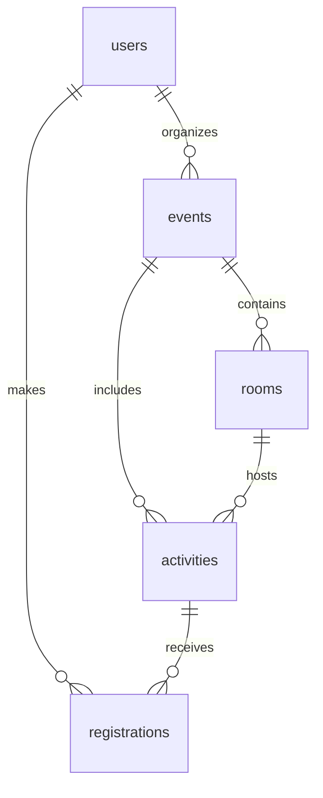

# База данных EventFlow

Первая миграция рассчитана на PostgreSQL 16+. Основа backend находится в `app/`.
Для новой базы применяйте схему через `uv run alembic upgrade head` из корня
репозитория (см. основной README). Прямой SQL ниже — альтернативный способ
без учёта версий Alembic; не применяйте оба способа к одной базе.
Миграция применяется один раз к пустой базе. Расширение `btree_gist` должно быть
доступно на сервере; для его установки могут понадобиться права владельца базы.

```sh
docker compose exec -T db psql -U eventflow -d eventflow -X -v ON_ERROR_STOP=1 < db/001_initial.sql
docker compose exec -T db psql -U eventflow -d eventflow -X -v ON_ERROR_STOP=1 < db/tests/constraints.sql
```

Команды выше используют локальный сокет внутри контейнера. Для внешнего `psql`
URL должен начинаться с `postgresql://`, а для SQLAlchemy в `.env` — с
`postgresql+psycopg://`.

`DATABASE_URL` задаётся локально или через секреты окружения. Пароли и URL с
паролями нельзя коммитить. Команды выполняются из корня репозитория.
Тесты вставляют данные внутри транзакции и откатывают их; используйте тестовую БД.

## Связи



- `users`: участники и организаторы; только хеш пароля, например Argon2id.
- `events`: мероприятие, его владелец, время, часовой пояс и публикация.
- `rooms`: аудитории конкретного мероприятия с вместимостью.
- `activities`: активности, назначенные в аудитории.
- `registrations`: действующие записи; отмена удаляет строку.

Время хранится в `timestamptz`, API принимает ISO 8601 со смещением.
`events.timezone` нужен для отображения и должен проверяться backend по IANA.
Пересечение: `a.starts_at < b.ends_at AND b.starts_at < a.ends_at`.
Активности встык разрешены. Аудитории считаются ресурсами одного мероприятия;
общие физические помещения нескольких мероприятий потребуют отдельной модели.

## Что гарантирует сама БД

- Непустые названия, положительная вместимость, начало раньше окончания.
- Email уникален без учёта регистра; формат email проверяет backend.
- Все ссылки существуют; аудитория принадлежит мероприятию активности.
- Одна действующая регистрация пользователя на активность.
- Две активности не пересекаются в одной аудитории, в том числе при
  конкурентных INSERT/UPDATE (ограничение EXCLUDE).

## Что должен гарантировать backend в транзакциях

Эти правила **ещё не реализованы**. Одних ограничений схемы недостаточно для MVP:

- Проверять роль, владельца мероприятия и принадлежность регистрации текущему
  пользователю на сервере. Новые аккаунты получают роль participant; клиент
  не должен самостоятельно назначать себе organizer.
- Проверять публикацию мероприятия, границы времени активности и валидность
  часового пояса. Лимит активности не должен превышать вместимость аудитории.
- Запрещать снижение лимита ниже числа записей, а вместимости аудитории — ниже
  лимитов назначенных активностей.
- При записи атомарно проверять количество мест и пересечения со всеми
  регистрациями участника, включая другие мероприятия. Счётчик свободных мест
  вычисляется как `activities.capacity - count(registrations.id)`.
- Перенос, создающий конфликт у записанного участника, полностью отклонять.
  Это выбранная для MVP политика; документ задания допускает такой вариант.
- Личное расписание получать JOIN-ом registrations → activities → rooms,
  чтобы переносы отражались без копирования времени и аудитории в регистрации.

### Простой протокол конкурентного доступа для первого MVP

Для первого backend рекомендуется сериализовать все изменения расписания и
регистраций одной транзакционной advisory-блокировкой:

```sql
BEGIN; -- стандартный READ COMMITTED
SELECT pg_advisory_xact_lock(17001, 1);
-- Следующими SQL-запросами проверить права, места и конфликты.
-- Затем выполнить INSERT / UPDATE / DELETE.
COMMIT;
```

Это **соглашение backend**, а не автоматически действующее ограничение БД.
Его обязаны соблюдать все операции записи, отмены, переноса, изменения лимитов,
аудиторий и дат мероприятия. Проверки выполняются отдельными запросами после
получения блокировки, внутри той же транзакции и на том же соединении.
При нарушении правил — ROLLBACK. Не выполнять сетевые вызовы внутри транзакции.

Так два последних места не будут проданы одновременно, а параллельные записи
участника не обойдут проверку пересечений. Для учебного MVP это проще и надёжнее
сложной системы нескольких блокировок. Блокировка сериализует изменения во всех
мероприятиях; чтение свободно, но пропускную способность записей нужно измерять.
Позже можно перейти к более узким блокировкам с отдельными конкурентными тестами.

Имена организаторов и списки участников получают из users. Удаление пользователя
или активности с регистрациями по умолчанию запрещено внешними ключами; для MVP
лучше редактировать существующие записи, а удаление с историей проектировать отдельно.
